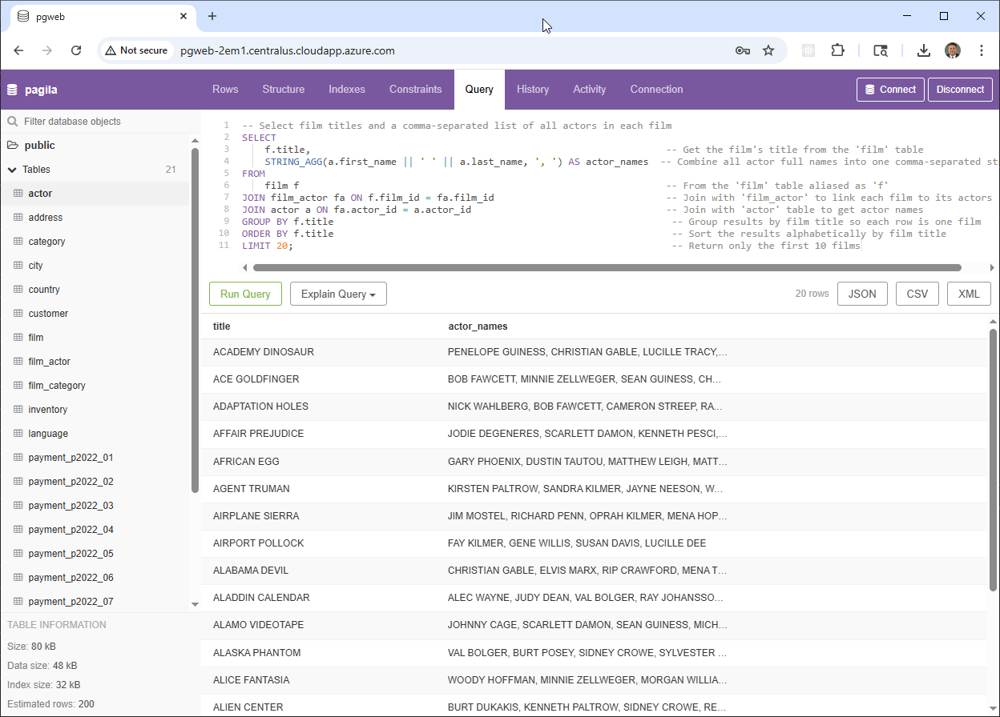
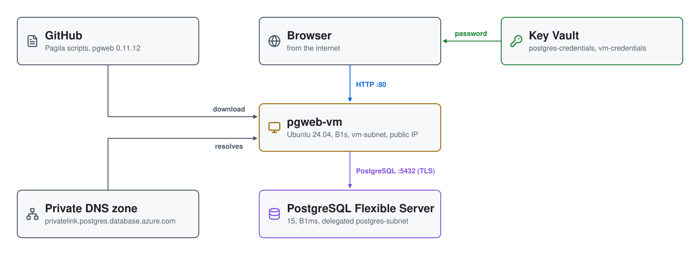

# PostgreSQL on Azure: Azure Database for PostgreSQL Flexible Server with pgweb

A private **Azure Database for PostgreSQL Flexible Server**, built with
Terraform and loaded with the
[Pagila](https://www.postgresql.org/ftp/projects/pgFoundry/dbsamples/pagila/)
sample database. The server has no public endpoint; a **pgweb** VM with a
public IP gives you a browser client for it.



| Piece | Where | Role |
|---|---|---|
| **PostgreSQL Flexible Server** | `postgres-subnet` (delegated) | `postgres-instance-<suffix>`, PostgreSQL 15, `B_Standard_B1ms`, 32 GB, 7-day backups, zone 1; VNet-integrated, public access disabled |
| **Private DNS zone** | linked to `postgres-vnet` | `privatelink.postgres.database.azure.com`, so the server's name resolves to its private IP |
| **pgweb-vm** | `vm-subnet`, public IP | Ubuntu 24.04, `Standard_B1s`; loads Pagila, then serves pgweb 0.11.12 on port 80 |
| **Key Vault** | `postgres-rg` | `creds-kv-<suffix>`: `postgres-credentials` (database admin) and `vm-credentials` (VM login) |

## Architecture

<picture>
  <source media="(prefers-color-scheme: dark)" srcset="architecture-dark.svg">
  
</picture>

Regenerate with `python3 make_diagram.py`.

- **`01-postgres/`** is the whole stack: the resource group (`postgres-rg`),
  the VNet (`postgres-vnet`, 10.0.0.0/23) with the delegated
  `postgres-subnet` (10.0.0.0/25) and `vm-subnet` (10.0.1.0/25), the NSGs,
  the private DNS zone, the Flexible Server, the Key Vault and passwords, and
  the pgweb VM.
- **`01-postgres/data/`** holds the Pagila load scripts (`pagila-db.sql`,
  `pagila-schema.sql`, `pagila-data.sql`) and the sample queries.

## How it boots

1. Terraform builds the network, the Key Vault, the Flexible Server and the
   VM, generating 24-character passwords for the `postgres` database admin
   and the `sysadmin` VM login.
2. The VM installs the PostgreSQL client, clones this repository, and loads
   Pagila with `psql`. Output is in `/tmp/db_load.log`.
3. It downloads pgweb 0.11.12 from GitHub and runs it as a systemd service on
   port 80. pgweb starts without a connection; you enter one when you open it.

## Network security

```
internet ─80, 22─▶ pgweb-vm ─5432─▶ PostgreSQL Flexible Server (delegated subnet)
```

| NSG | Subnet | Allows |
|---|---|---|
| `vm-nsg` | `vm-subnet` | 80 and 22 from anywhere |
| `postgres-nsg` | `postgres-subnet` | 5432 from anywhere |

The server is VNet-integrated with public access disabled, so `postgres-nsg`
only matters inside the VNet.

## Prerequisites

* [An Azure Account](https://portal.azure.com/)
* [Install AZ CLI](https://learn.microsoft.com/en-us/cli/azure/install-azure-cli)
* [Install Terraform](https://developer.hashicorp.com/terraform/install)
* [Install jq](https://jqlang.github.io/jq/download/)

`check_env.sh` expects a service principal in `ARM_CLIENT_ID`,
`ARM_CLIENT_SECRET`, `ARM_SUBSCRIPTION_ID` and `ARM_TENANT_ID`. If this is
your first time watching our content, we recommend starting with this video:
[Azure + Terraform: Easy Setup](https://youtu.be/j4aRjgH5H8Q).

## Deploy

```bash
git clone https://github.com/mamonaco1973/azure-postgres.git
cd azure-postgres
./apply.sh       # one phase: VNet, Key Vault, Flexible Server, pgweb VM
```

Everything deploys to Central US. `apply.sh` ends by running `validate.sh`,
which waits for pgweb to answer (up to 15 minutes) and prints:

```
===============================================================================
BUILD VALIDATION RESULTS
===============================================================================
pgweb URL:
  http://pgweb-a1b2.centralus.cloudapp.azure.com/

PostgreSQL Flexible Server Endpoint:
  postgres-instance-a1b2.postgres.database.azure.com
===============================================================================
```

## Try it

1. Get the database password from Key Vault:

   ```bash
   vault=$(az keyvault list -g postgres-rg --query "[0].name" -o tsv)
   az keyvault secret show --vault-name "$vault" --name postgres-credentials \
     --query value -o tsv | jq -r .password
   ```

2. Open the pgweb URL and connect with the server endpoint from
   `validate.sh`, user `postgres`, that password, database `pagila`, and SSL
   mode `require`.
3. Run the sample queries from the **Query** tab (`01-postgres/data/`):

   ```sql
   SELECT
       f.title AS film_title,
       a.first_name || ' ' || a.last_name AS actor_name
   FROM film f
   JOIN film_actor fa ON f.film_id = fa.film_id
   JOIN actor a ON fa.actor_id = a.actor_id
   ORDER BY f.title, actor_name
   LIMIT 20;
   ```

   ```sql
   SELECT
       f.title,
       STRING_AGG(a.first_name || ' ' || a.last_name, ', ') AS actor_names
   FROM film f
   JOIN film_actor fa ON f.film_id = fa.film_id
   JOIN actor a ON fa.actor_id = a.actor_id
   GROUP BY f.title
   ORDER BY f.title
   LIMIT 10;
   ```

## Troubleshooting

| Symptom | Fix |
|---|---|
| `validate.sh` keeps retrying | The VM is still installing. SSH in as `sysadmin` (password in `vm-credentials`) and `sudo tail /var/log/cloud-init-output.log`. |
| `pagila` is missing | Read `/tmp/db_load.log` on the VM for the `psql` output. |
| pgweb can't connect | Set SSL mode to `require`, and use the password from `postgres-credentials`, not `vm-credentials`. |
| You want a local client | The server is private. Connect from the VM (`psql "host=<endpoint> user=postgres dbname=pagila sslmode=require"`). |

## Teardown

```bash
./destroy.sh     # destroys the whole stack, including the Key Vault
```

## Notes

- **Lab only.** pgweb is open to the internet over plain HTTP with no
  sign-in of its own and runs as root, SSH accepts password logins from
  anywhere, and the database password is in the VM's custom data. Restrict
  `vm-nsg` and add TLS for anything more.
